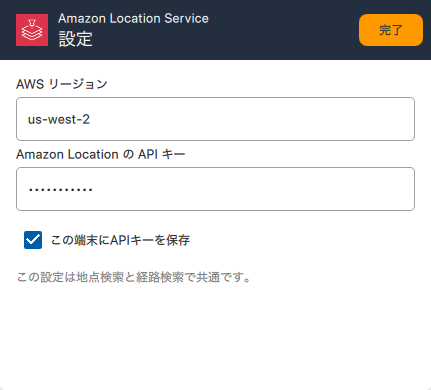
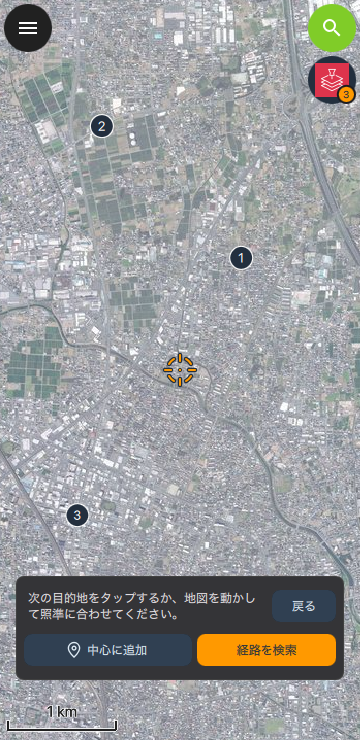
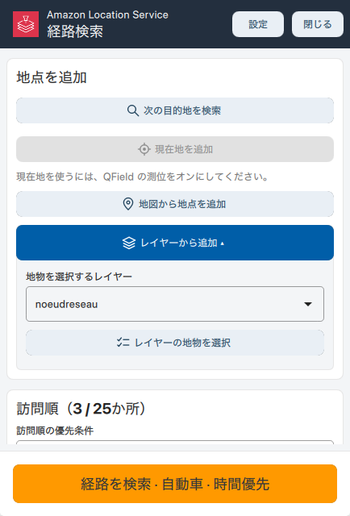
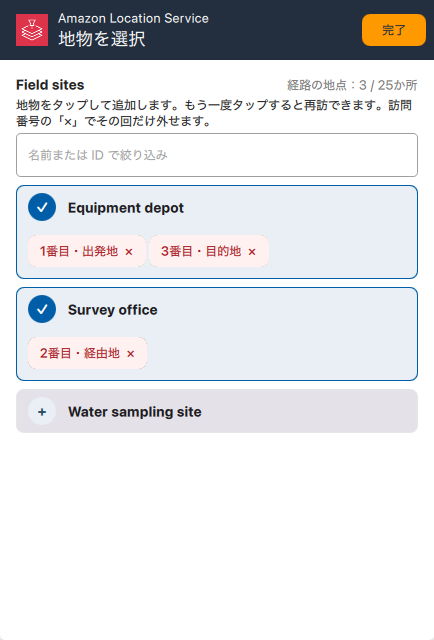

# Amazon Location Service for QField

QField の地図で地名や住所を検索し、現在地から目的地までの経路を表示するプラグインです。複数の地点を回るときは、距離や所要時間を基準に訪問順を最適化できます。[English guide](README.md)

## インストール

1. QField のサイドパネルでメニューを開き、「Plugin Manager」を選びます。
2. 「URLからプラグインをインストール」を選び、次の URL を入力します。

   ```text
   https://raw.githubusercontent.com/Yamazaki-Kei7/qfield-amazonlocationservice/main/amazon-location-service.zip
   ```

3. ローカルプラグインの一覧で「Amazon Location Service」を有効にします。実行許可を求められた場合は許可してください。

以前の `amazon-location-routes.zip` を利用していた場合は、旧プラグインを無効にしてください。QField 4.2.6 以降では、QField を日本語に設定するとこのプラグインも日本語で表示されます。それより前のバージョンでは英語で表示されます。言語を変更したあとも以前の言語が表示される場合は、QField を再起動してください。

## 接続設定

地図右上の Amazon Location Service ボタンをタップし、カプセル内の「地点検索」または「経路検索」を開きます。どちらかの画面で「設定」を開き、API キーを作成した AWS リージョン（例：`ap-northeast-1`）とキーを入力します。再起動後も同じキーを使う場合は「この端末にAPIキーを保存」にチェックを入れ、「完了」をタップします。

リージョンは端末に自動で保存されます。保存を選んだ API キーは、QField のローカル設定に平文で保存されます。保存済みのキーを消すには、チェックを外して「完了」をタップします。その場合も、現在のセッションでは引き続きキーを使えます。



| 利用する機能 | API キーに必要な権限 |
| --- | --- |
| 地名・住所の検索 | `geo-places:SearchText` |
| 経路の背景地図（通常地図・衛星写真） | `geo-maps:GetStaticMap` |
| 経路検索 | `geo-routes:CalculateRoutes` |
| 訪問順の最適化 | `geo-routes:OptimizeWaypoints` |

## 地点を探す

「地点検索」に地名、住所、「図書館」などのキーワードを入力して「検索」をタップします。地図の中心に近い候補が優先されます。候補をタップすると地図上にピンが表示され、「検索結果に戻る」で別の候補を確認できます。検索結果の地名と住所は AWS に日本語でリクエストします。実際の表記は地域や提供データによって異なります。

## 経路を調べる

1. QField の測位をオンにして「経路検索」を開き、移動手段を選びます。
2. 「現在地を出発地にする」をタップし、「目的地を検索」で行き先を選びます。地図やレイヤーの地物からも地点を追加できます。
3. 訪問順を確認し、「経路を探索」をタップします。自動車で距離優先を選んだ場合は「経路を探索（自動車・距離優先）」と表示されます。地図に経路と地点番号が表示されます。

経路探索に成功すると、QField はレイヤーパネル内の全レイヤーをオフにし、地図キャンバスに Amazon の通常地図と経路を表示します。右上のサービスカプセル内で「通常地図」「衛星写真」を選べます。切り替えても表示範囲と経路は保たれます。重ねたいレイヤーをパネルでオンにすると、Amazon の地図の上に描画されます。地点検索時と経路探索失敗時は、背景地図とレイヤーの表示状態を維持します。

表示中の画像の範囲を越えて移動したとき、縮尺を大きく変えたとき、地図の種類を選んだときに Amazon Location Service から地図画像を取得します。画像の取得は課金対象です。キーの許可リソースに同じリージョンの Maps プロバイダー（東京なら `arn:aws:geo-maps:ap-northeast-1::provider/default`）を含めてください。シンガポールとマレーシアのリージョンで GrabMaps を使用する場合は地図画像を取得できません。[GetStaticMap API](https://docs.aws.amazon.com/location/latest/APIReference/API_geomaps_GetStaticMap.html)

利用前に設定画面から AWS サービス条件を確認し、ご自身の責任で地図と検索結果をご利用ください。経路と背景地図の組み合わせに関する条件は第82.5条(b)に記載されています。[AWS サービス条件](https://aws.amazon.com/jp/service-terms/)・[地図データの出典](https://docs.aws.amazon.com/location/latest/developerguide/data-attribution.html)

自動車・徒歩・スクーター・トラックでは、出発地と目的地を含めて最大25か所を指定できます。公共交通機関と「複数の交通手段」は出発地と目的地の2か所を指定し、現在時刻を出発時刻として検索します。

「地図から地点を追加」を開くと、地図をタップして訪問順に地点を追加できます。位置を細かく指定するには、地図を拡大して目的の位置を中央のオレンジ色の照準に合わせ、「中心に追加」をタップします。「戻る」で訪問順を確認でき、2か所以上そろえば地図から「経路を検索」を選べます。



地物を経路に追加するには、「レイヤーから追加」でレイヤーを選び、「レイヤーの地物を選択」を開きます。



「地図で選択」を押すと、地図を見ながら対象レイヤーの地物を訪問順にタップできます。同じ位置に複数の候補がある場合は、名前と地物 ID を確認して選びます。「完了」で経路検索に、「リストに戻る」で地物一覧に戻ります。

一覧では名前や ID で絞り込んで地物を追加できます。同じ地物をもう一度タップすると再訪できます。間違えて追加したときは、地物名の下にある「1番目・出発地 ×」などのボタンをタップすると、その訪問だけを経路から外せます。地点数が上限に達したときも使えます。



## 訪問順を最適化する

自動車・徒歩・スクーター・トラックで3か所以上を指定すると、「訪問順を最適化」が使えます。「訪問順の優先条件」で「距離優先」または「時間優先」を選びます。出発地は固定されます。目的地も固定するときは、4か所以上を指定し、「最後の地点を目的地に固定」をオンにします。

最適化したら「経路を探索」をタップして地図に反映します。手動で変更するには、地点の番号を上下にドラッグするか、矢印ボタンを使います。

訪問順の一覧では、地点カード右端の「×」をタップすると、その訪問だけを削除できます。全地点と表示中の経路をまとめて消すには、一覧の下にある「すべて削除」をタップします。

## 接続できないとき

- HTTP 403 が表示された場合は、キーの有効期限、AWS リージョン、利用する機能の権限を確認してください。
- 現在地を取得できない場合は、QField の測位状態を確認するか、「地図から地点を追加」で出発地を指定してください。
- 訪問順の最適化では、全地点を囲む長方形の周長が 500 km を超えるとエラーになります。範囲を狭めるか、手動で訪問順を指定してください。

検索にはインターネット接続が必要です。地点検索では検索語と地図中心の座標を、経路検索と最適化では選んだ地点の座標を Amazon Location Service に送信します。地点検索、経路検索、訪問順の最適化は、それぞれ Amazon Location Service の課金対象です。スクーターでの最適化、全地点を囲む長方形の周長が 200 km を超える最適化、「複数の交通手段」の経路検索には Premium 料金が適用されます。[AWS の料金表](https://aws.amazon.com/jp/location/pricing/)
