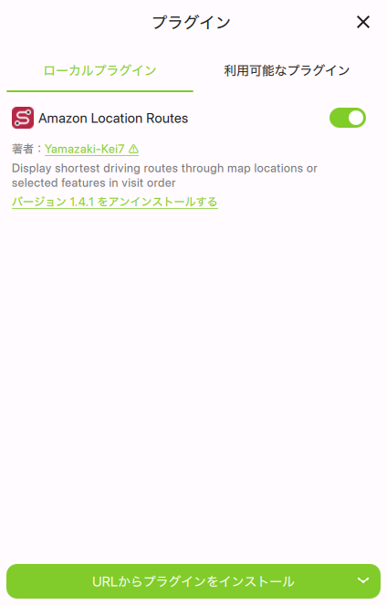

# Amazon Location Routes for QField

QField の地図で、**指定した訪問順**に 2〜25 地点を車で巡る経路を表示するプラグインです。地図をタップするか、レイヤ内の地物を選んで地点を追加します。Amazon Location Service は、その訪問順で走行距離が短くなる経路を検索します。[CalculateRoutes の仕様](https://docs.aws.amazon.com/location/latest/APIReference/API_CalculateRoutes.html)

## 必要なもの

- プラグインに対応した QField
- インターネット接続（経路検索のたびに通信します）
- `geo-routes:CalculateRoutes` を許可した Amazon Location Service の API キーと、そのキーを作成した AWS リージョン名（例：`ap-northeast-1`）

API キーは AWS マネジメントコンソールの Amazon Location Service で作成します。手順は [API キーのドキュメント](https://docs.aws.amazon.com/location/latest/developerguide/using-apikeys.html)を参照してください。許可するアクションは CalculateRoutes だけにしておくと安全です。

## インストール

### URL からインストールする（おすすめ）

1. QField のサイドダッシュボードを開き、メニューの「Plugin Manager」をタップします。

   

2. プラグイン管理画面の下部にある「URL からプラグインをインストール」をタップします。入力欄に次の URL を貼り付け、「OK」を押します。

   ```text
   https://raw.githubusercontent.com/Yamazaki-Kei7/qfield-amazonlocationservice/main/amazon-location-routes.zip
   ```

   

3. 「ローカルプラグイン」タブで「Amazon Location Routes」を確認し、右側のスイッチをオンにします。実行の許可を求めるダイアログが出たら許可してください。下の画像は有効になった状態です。

   

プラグイン管理画面の場所やボタンの表記は QField のバージョンによって異なります。見つからない場合は [QField のプラグインのドキュメント](https://docs.qfield.org/how-to/advanced-how-tos/plugins/)を確認してください。

### ZIP を手動で配置する

URL からインストールできない環境では、[amazon-location-routes.zip](https://raw.githubusercontent.com/Yamazaki-Kei7/qfield-amazonlocationservice/main/amazon-location-routes.zip) をダウンロードして展開し、QField のアプリデータ内に `plugins/amazon-location-routes/main.qml` がある構成で配置します。QField を再起動し、プラグイン管理画面で有効にしてください。

## 使い方

### 1. 経路検索を開いて接続設定を入力する

QField でプロジェクトを開き、プラグインツールバーの経路ボタンをタップします。「接続設定」に API キーを作成した AWS リージョンと、その API キーを入力します。下の例では接続設定が済んでいても、まだ地点が 0 件なので検索ボタンは灰色です。


### 2. 訪問する順に地点を追加する

**地図から追加する場合**は「地図をタップして地点を追加」を押し、出発地から順に地図をタップします。下の例では、黒い丸の **1 が出発地、2 が経由地、3 が目的地**です。


2 地点以上を追加したら、その順でよければ地図下部の「経路を検索」を押して手順 4 に進みます。「接続設定を入力」と表示された場合は、そこから手順 1 の入力欄に戻れます。

**レイヤから追加する場合**は、経路検索画面の「地物を選ぶレイヤ」で対象のレイヤを選び、「レイヤの地物を選択」を押します。下の一覧で地物名を訪問順にタップすると、画面上部の地点数が増えます。必要な地点を追加したら、右上の「選択を終了」を押して訪問順を確認します。地図で指定した地点と組み合わせることもできます。


### 3. 訪問順を確認して検索する

地図で地点を追加している場合は、右上の地点数が付いた経路ボタンを押すと、経路検索画面に戻れます。「訪問順」までスクロールし、上から出発地、経由地、目的地の順に並んでいることを確認します。


順番を変えるには、カード左端の番号を上下にドラッグするか、右端の「↑」「↓」で 1 つずつ移動します。「末尾の地点を削除」を押すと一覧の最後の地点が消えます。「全消去」を押すと地点と経路がすべて消えます。

訪問順が決まったら「指定順で最短経路を検索」を押します。

### 4. 地図で経路を確認する

検索が完了すると地図に戻り、経路全体が表示されます。下の例では、青い線が **1 → 2 → 3** の順に道路を通る経路です。経路と地点番号は地図上の一時表示で、プロジェクトの地物は変更されません。


### 知っておくと便利なこと

- 「指定順で最短経路を検索」が押せないときは、ボタンの上に不足している項目が表示されます。地点が2つ以上あり、接続設定がそろうとボタンがオレンジ色になります。
- 地物で指定した場合、点はその位置、線・面・マルチパート地物は重心を使います。建物の出入口など特定の位置から検索したいときは、地図をタップして指定してください。
- 地点の追加・並べ替え・削除をすると、表示済みの経路は消えます。新しい順序でもう一度検索してください。
- 別のプロジェクトを開くと、地点と経路はクリアされます。
- API キーは端末に保存しません。QField を再起動したときは入力し直してください。

## うまくいかないとき

| 表示・症状 | 確認すること |
| --- | --- |
| ツールバーに経路ボタンが出ない | プラグイン管理画面でスイッチがオンになっているか、実行を許可したかを確認します。 |
| 「通信できません。接続を確認してください。」 | インターネット接続と、リージョン名の入力ミスがないかを確認します。 |
| 「検索できませんでした（HTTP …）。」 | API キーが正しく有効期限内か、`geo-routes:CalculateRoutes` を許可しているか、キーを作成したリージョンを入力しているかを確認します。地点が道路から大きく離れている場合にも表示されることがあります。 |
| 「全区間を通る経路が見つかりませんでした。」 | 車でたどり着けない地点（海上や道路のない場所など）が含まれていないかを確認します。 |
| 「応答がありません。接続を確認して再検索してください。」 | 45 秒以内に応答がなかった場合に表示されます。通信環境のよい場所で再検索します。 |

## 注意事項

- 経路検索は Amazon Location Service の利用料金の対象です。詳しくは[料金ページ](https://aws.amazon.com/location/pricing/)を確認してください。
- 検索時には、指定した地点の座標と API キーを Amazon Location Service に送信します。
- 移動手段は車のみです。

## 開発者向け

配布用の ZIP は、このディレクトリで次のコマンドを実行して作成します。

```sh
zip -j amazon-location-routes.zip main.qml Routes.js metadata.txt icon.svg LICENSE
```

URL からのインストールでは `main` ブランチの `amazon-location-routes.zip` がそのまま配布されます。ソースを変更したら、`metadata.txt` の `version` を更新し、ZIP を作り直してコミットしてください。

## ライセンス

ライセンスは同梱の [LICENSE](LICENSE)（GNU GPL v2）を参照してください。
