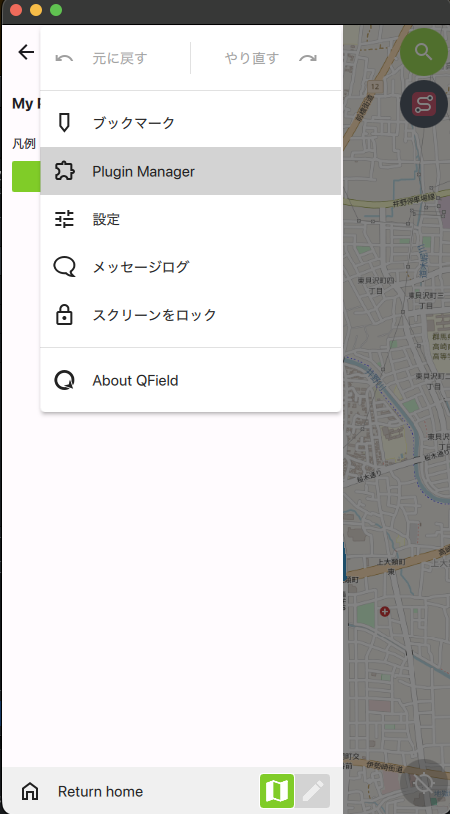
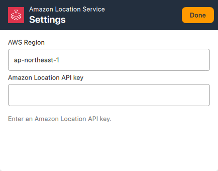
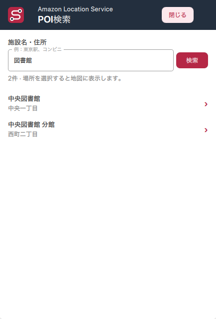
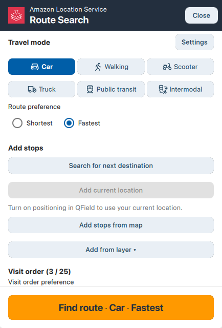
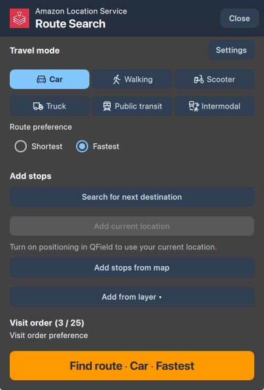
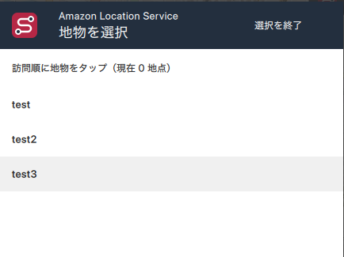

# Amazon Location Service for QField

[日本語の使い方](README.ja.md)

Search for a place or address, then get directions to it from your current location. For fieldwork with multiple stops, choose a travel mode and optimize the visit order for distance or travel time.

## Requirements

- A version of QField that supports plugins
- An internet connection
- An Amazon Location Service API key and the AWS Region where it was created (for example, `ap-northeast-1`)

| Feature | API key action to allow |
| --- | --- |
| Search for places by name or address | `geo-places:SearchText` |
| Find routes for any travel mode | `geo-routes:CalculateRoutes` |
| Optimize visit order | `geo-routes:OptimizeWaypoints` |

To use more than one feature, allow all the required actions on the same key. For an existing route-search key, add `geo-places:SearchText` for place search and `geo-routes:OptimizeWaypoints` for visit order optimization as needed. See [API key configuration](https://docs.aws.amazon.com/location/latest/developerguide/using-apikeys.html).

## Installation

If you are switching from the old ZIP (`amazon-location-routes.zip`), first disable the old version in Plugin Manager. QField uses the ZIP filename to determine the installation directory, so the old and new plugins are registered separately.

### Install from a URL (recommended)

1. Open the side dashboard in QField, open its menu, and tap **Plugin Manager**.

   

2. At the bottom of Plugin Manager, tap **Install plugin from URL**. Paste the following URL into the field and tap **OK**.

   ```text
   https://raw.githubusercontent.com/Yamazaki-Kei7/qfield-amazonlocationservice/main/amazon-location-service.zip
   ```

   

3. On the **Local Plugins** tab, turn on the switch beside **Amazon Location Service**. If prompted to allow the plugin to run, grant permission.

The location and wording of Plugin Manager controls can vary between QField versions. If you cannot find them, see the [QField plugin documentation](https://docs.qfield.org/how-to/advanced-how-tos/plugins/).

### Install the ZIP manually

If installation from a URL is unavailable, download [amazon-location-service.zip](https://raw.githubusercontent.com/Yamazaki-Kei7/qfield-amazonlocationservice/main/amazon-location-service.zip), extract it, and place it in QField's application data so that the file `plugins/amazon-location-service/main.qml` exists. Restart QField and enable the plugin in Plugin Manager.

## Usage

### Connection settings

Tap the Amazon Location Service button at the upper right of the map. The pin opens **Place Search** and the route line opens **Route Search**. Tap the service button again to close the menu.


In either search screen, tap **Settings**, enter the **AWS Region** where you created your key and the **Amazon Location API key**, then tap **Done**. Both searches use these settings.



### Find a place and show it on the map

Open the service menu and select **Place Search**. Enter a place name, address, or keyword such as `library`, then tap **Search**. Results near the map center are prioritized. Review the names and addresses, then select a result to move the map to that place and show a marker. Tap **Back to results** to compare another place.

The screenshot shows sample results for a library search.



On the map, tap **Route from current location** to open Route Search with your current location as the origin and the selected place as the destination. If your location is unavailable, tap **Route to here** and choose an origin. If you already have a visit order, use **Add as destination** to add the place at the end.

### Find a route from your current location

1. Turn on positioning in QField, then open the service menu and select **Route Search**. Under **Travel mode**, choose Car, Walking, Scooter, Truck, Public transit, or Intermodal, then tap **Use current location as origin**. Car is selected by default. The origin is fixed at your location when you tap the button.
2. Tap **Search for destination**, search for a place name or address, and select a result. If you choose the destination first, you can then add the origin from your current location, the map, a layer, or place search.
3. Check the stops and tap the **Find route** button at the bottom. Car, Walking, Scooter, and Truck visit 2–25 stops in the specified order. For Car and Truck, choose **Shortest** (the default) or **Fastest** under **Route preference**. Walking and Scooter use the fastest route. Public transit and Intermodal use two stops, an origin and a destination, and search for a departure at the current time. Intermodal routes can combine walking, public transit, taxis, and other modes. See [AWS travel modes](https://docs.aws.amazon.com/location/latest/developerguide/concepts-how.html).




### Add stops from the map or a layer

Tap **Add stops from map**, then tap a location to add it to the visit order. For precise placement, zoom in, move the map until the orange crosshair is over the location, and tap **Add at center**. You can use either method for each stop. In the example below, **1** is the origin, **2** is a waypoint, and **3** is the destination.


After adding at least two stops, tap **Find route** at the bottom of the map to search in that order. If **Enter settings** appears instead, tap it to enter the Region and API key.

**To add stops from a layer**, open **Add from layer** in Route Search, choose a layer under **Layer for feature selection**, and tap **Select layer features**. In **Filter by name or ID**, type part of the display name or a feature ID (for example, `42` or `FID 42`). Names match regardless of case. Tap **Clear** to show the whole layer again.

Tap a feature card to add it. A checkmark and visit number show its position in the route. You can change the filter to find your next stop and keep the visits already added. Tap the same card again to add a return visit. The card then lists both visit numbers. Tap **Done** to return to the route.

The feature names in the image below are sample data.



### Review the visit order and find a route

While you add stops from the map, the service button shows the stop count. Tap **Back** to review the origin, waypoints, and destination under **Visit order**.


To change the order, drag the number at the left of a stop card up or down, or use the **↑** and **↓** buttons at the right to move it one position. **Remove last** removes the last stop. **Clear all** removes all stops and the displayed route.

When the order is ready, tap the **Find route** button at the bottom. Your stops and their order are retained if you change the travel mode and search again.

### Optimize the visit order

With Car, Walking, Scooter, or Truck and at least three stops, **Optimize order** appears under **Visit order**. By default, **Same as route** applies the route preference to the visit order. To choose a different preference for the visit order, select **Shortest** or **Fastest** under **Visit order preference**, then tap **Optimize order**. The first stop remains the origin. For example, even when walking, you can optimize the stop order for distance while each route leg uses the fastest route. See [AWS route and waypoint optimization](https://docs.aws.amazon.com/location/latest/developerguide/optimize-route-waypoint.html#optimize-routing).

- **To keep a particular destination**, put it last in the list and enable **Keep last stop as destination** before optimizing. The origin and destination remain fixed while the intermediate stops are reordered. At least four stops are required.
- **To return to the origin**, add the same location as the last stop and enable **Keep last stop as destination** before optimizing.
- After optimization, an estimated total distance and travel time are displayed. Review the new order in the list and the numbered map markers, and adjust it with drag or **↑** and **↓** if needed. **Restore original order** restores the order from before optimization. It is no longer available after you add, remove, or manually reorder stops.
- Optimization changes the visit order only. Tap the **Find route** button at the bottom to display the route on the map.

### View the route on the map

Once the search completes, the map displays the entire route. In the example below, the blue line follows roads in the order **1 → 2 → 3**. The route and numbered stops appear as temporary overlays on your project map.


### Useful details

- If the route search button is disabled, check the guidance above it. If switching to Public transit or Intermodal leaves three or more stops, reduce the list to two stops or choose a mode that supports waypoints.
- A point feature contributes its location. For lines, polygons, and multipart features, the plugin uses the centroid. To search from a specific location, such as a building entrance, select it on the map.
- Adding, reordering, or removing stops clears a displayed route. Changing the order through optimization does the same. Search again to display the route for the new order.
- Visit order optimization cannot be used when the perimeter of the bounding box around all stops exceeds 500 km. Reduce the stops or reorder them manually and search for a route.
- Opening a different project clears the place marker, stops, and route.
- The plugin keeps the API key in memory for the current session. Enter it again after restarting QField.

## Troubleshooting

| Message or symptom | What to check |
| --- | --- |
| The service button does not appear at the upper right of the map | Check that the plugin is enabled in Plugin Manager and that you allowed it to run. |
| Place Search returns HTTP 403 | Check the key's expiration, Region, and `geo-places:SearchText` permission. |
| Cannot add the current location | Check location settings in QField and on the device, and wait for a valid position fix. You can also choose an origin from the map, a layer, or place search. |
| “Could not connect. Check your connection.” | Check your internet connection and the spelling of the Region. |
| Route search returns HTTP 400 | Check the AWS message following the error to see which stops or search parameters were rejected. |
| Route search returns HTTP 403 | Check that the API key is valid and unexpired, that it allows `geo-routes:CalculateRoutes`, and that the Region matches the one in which the key was created. |
| “Could not optimize visit order (HTTP 403).” | Allow `geo-routes:OptimizeWaypoints` on the API key. Optimization requires a separate permission even if route search works. |
| “Could not optimize visit order. The bounding box ... exceeding the 500 km limit.” | The stops are spread over too large an area. Remove stops or optimize only stops in a smaller area. |
| “Could not optimize visit order. No valid order includes ...” | Check whether the selected travel mode can reach the named stops. If a stop is far from a road, tap the map to choose a point closer to one. |
| “No route was found for all legs.” | Check whether the selected travel mode can reach each stop. Coverage for Public transit and Intermodal varies by region and transit operator. |
| “Request timed out. Check your connection and try again.” | No response was received within 45 seconds. Retry where the network connection is better. |

## Costs and privacy

- Place search, route search, and visit order optimization are subject to Amazon Location Service charges. See [AWS pricing](https://aws.amazon.com/location/pricing/).
- Place search sends your query and the coordinates of the map center to Amazon Location Service with the API key. Route search and visit order optimization send the coordinates of the selected stops with the key. Stop names stay on your device. See the [SearchText](https://docs.aws.amazon.com/location/latest/APIReference/API_geoplaces_SearchText.html), [CalculateRoutes](https://docs.aws.amazon.com/location/latest/APIReference/API_CalculateRoutes.html), and [OptimizeWaypoints](https://docs.aws.amazon.com/location/latest/APIReference/API_OptimizeWaypoints.html) specifications.
- Each **Optimize order** request is billed separately from route search. Scooter optimization and optimization with a bounding-box perimeter over 200 km are subject to Premium pricing.
- Intermodal route searches are subject to Premium pricing. See [AWS route pricing categories](https://docs.aws.amazon.com/location/latest/developerguide/routes-pricing.html).

## Development

QField loads `main_<language>.qm` from the plugin directory and uses the English source strings when no catalog is available. To update or add a language, extract the messages with Qt 6 Linguist tools, translate the `.ts` file (including the SearchText language code), and compile it. For Japanese, run the following in the project directory.

```sh
lupdate main.qml PlaceSearch.qml LocationRequest.qml Routes.js -locations none -target-language ja -ts main_ja.ts
# Edit main_ja.ts in Qt Linguist before compiling.
lrelease main_ja.ts -qm main_ja.qm
```

Build the distribution ZIP with the compiled translations.

```sh
zip amazon-location-service.zip main.qml main_*.qm PlaceSearch.qml LocationRequest.qml LocationButton.qml ButtonColors.js Routes.js metadata.txt icon.svg poi-search.svg Arch_Amazon-Location-Service_32.svg icons/*.svg LICENSE
```

Installation from a URL distributes `amazon-location-service.zip` directly from the `main` branch. After changing the source, update `version` in `metadata.txt`, rebuild the ZIP, and commit it.

## Map credits

The example field project uses aerial imagery from the Geospatial Information Authority of Japan. [GSI tile catalog](https://maps.gsi.go.jp/development/ichiran.html#seamlessphoto).

## License

The plugin is distributed under the [GNU General Public License v2](LICENSE).

The plugin icon uses the Amazon Location Service architecture icon distributed by AWS. See [AWS Architecture Icons](https://aws.amazon.com/architecture/icons/).
