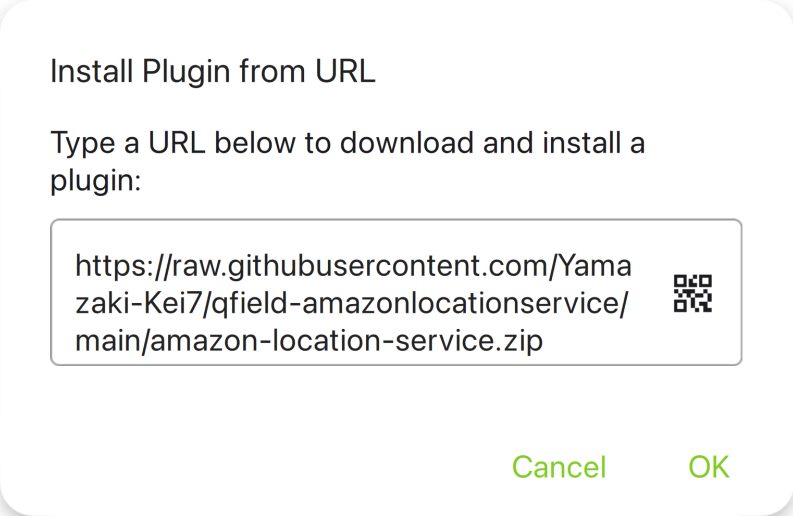
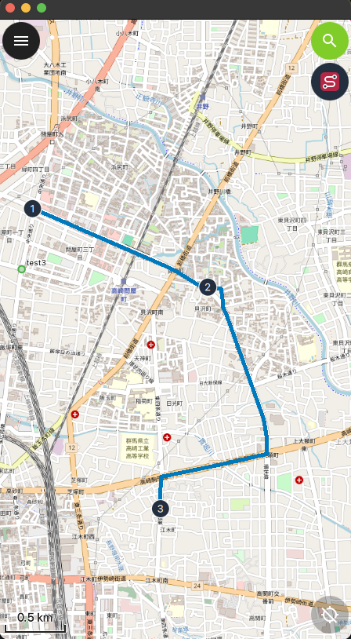

# Amazon Location Service for QField

QField で施設名や住所から場所を探し、地図に表示できます。経路検索では、移動手段を選んで、現在地や任意の出発地から目的地までの経路を地図に表示できます。複数の施設を回るときは、総移動距離が最短になるように訪問順を最適化できます。

## 必要なもの

- プラグインに対応した QField
- インターネット接続
- Amazon Location Service の API キーと、そのキーを作成した AWS リージョン名（例：`ap-northeast-1`）

| 使用する機能 | API キーに許可するアクション |
| --- | --- |
| 施設名・住所からの POI 検索 | `geo-places:SearchText` |
| 経路検索（全移動手段） | `geo-routes:CalculateRoutes` |
| 訪問順の最適化 | `geo-routes:OptimizeWaypoints` |

複数の機能を使う場合は、同じキーに必要なアクションをすべて許可してください。既存の経路検索用キーには、POI 検索を使うなら `geo-places:SearchText` を、訪問順の最適化を使うなら `geo-routes:OptimizeWaypoints` を追加します。[API キーの設定](https://docs.aws.amazon.com/location/latest/developerguide/using-apikeys.html)

## インストール

旧 ZIP（`amazon-location-routes.zip`）から切り替える場合は、先にプラグイン管理画面で旧版を無効にしてください。QField は ZIP のファイル名からインストール先を決めるため、新旧のプラグインが別々に登録されます。

### URL からインストールする（おすすめ）

1. QField のサイドダッシュボードを開き、メニューの「Plugin Manager」をタップします。

   

2. プラグイン管理画面の下部にある「URL からプラグインをインストール」をタップします。入力欄に次の URL を貼り付け、「OK」を押します。

   ```text
   https://raw.githubusercontent.com/Yamazaki-Kei7/qfield-amazonlocationservice/main/amazon-location-service.zip
   ```

   

3. 「ローカルプラグイン」タブで 「Amazon Location Service」の右側にあるスイッチをオンにします。実行の許可を求めるダイアログが出たら許可してください。

プラグイン管理画面の場所やボタンの表記は QField のバージョンによって異なります。見つからない場合は [QField のプラグインのドキュメント](https://docs.qfield.org/how-to/advanced-how-tos/plugins/)を確認してください。

### ZIP を手動で配置する

URL からインストールできない環境では、[amazon-location-service.zip](https://raw.githubusercontent.com/Yamazaki-Kei7/qfield-amazonlocationservice/main/amazon-location-service.zip) をダウンロードして展開し、QField のアプリデータ内に `plugins/amazon-location-service/main.qml` がある構成で配置します。QField を再起動し、プラグイン管理画面で有効にしてください。

## 使い方

### 接続設定

地図右上の赤いサービスボタン  をタップすると、その下に「POI検索」（地図ピン）と「経路検索」（経路線）の丸いボタンが縦に並びます。サービスボタンをもう一度タップすると、2つのボタンを収納できます。検索ボタンを選ぶと、その検索画面が開き、地図上のボタンは収納されます。初回は検索画面の「接続設定」で AWS リージョンと API キーを入力して「完了」を押します。設定は両方の機能で共通です。


### 場所を探して地図に表示する

サービスボタン → 「POI検索」を選び、施設名・住所・「コンビニ」などのキーワードを入力して「検索」を押します。地図の中心に近い候補が優先されます。施設名と住所を確認して候補を選ぶと、地図がその場所に移動してマーカーが付きます。「候補に戻る」で別の場所を見比べられます。


地図で「現在地からの経路」を押すと、現在地を出発地、表示中の場所を目的地として経路画面が開きます。測位していない場合は「ここへの経路」を押して出発地を選んでください。すでに訪問順がある場合は「目的地として追加」でその末尾に追加できます。

### 現在地から目的地までの経路を検索する

1. QField の測位をオンにして、サービスボタン → 「経路検索」を開きます。「移動手段」で車・徒歩・スクーター・トラック・公共交通・複合移動のアイコンを1つ選び、「現在地を出発地にする」を押します。初期選択は車です。現在地は押した時点の位置で固定されます。
2. 「目的地をPOI検索」で施設名や住所を検索し、候補をタップします。目的地を先に選んだ場合は、次に現在地・地図・レイヤ・POI検索から出発地を追加できます。
3. 地点を確認し、画面下部の検索ボタンを押します。車・徒歩・スクーター・トラックは、指定した順に2〜25地点を巡る最短距離の経路を検索します。公共交通と複合移動は、出発地と目的地の2地点を指定し、現在時刻に出発する経路を検索します。複合移動では徒歩、公共交通、タクシーなどを組み合わせます。[AWSの移動手段一覧](https://docs.aws.amazon.com/location/latest/developerguide/concepts-how.html)


### 地図やレイヤから地点を追加する

**地図から追加する場合**は「地図をタップして地点を追加」を押し、出発地から順に地図をタップします。下の例では、黒い丸の **1 が出発地、2 が経由地、3 が目的地**です。


2 地点以上を追加したら、その順でよければ地図下部の「経路を検索」を押すと経路が表示されます。「接続設定を入力」と表示された場合は、タップしてリージョンとキーを入力できます。

**レイヤから追加する場合**は、経路検索画面で「レイヤから追加」を開き、「地物を選ぶレイヤ」で対象のレイヤを選び、「レイヤの地物を選択」を押します。下の一覧で地物名を訪問順にタップすると、画面上部の地点数が増えます。必要な地点を追加したら、右上の「選択を終了」を押して訪問順を確認します。地図で指定した地点と組み合わせることもできます。


### 訪問順を確認して検索する

地図で地点を追加している間は、サービスボタンに地点数が表示されます。サービスボタン → 「経路検索」で経路検索画面に戻り、「訪問順」の一覧で上から出発地、経由地、目的地の順に並んでいることを確認します。


順番を変えるには、カード左端の番号を上下にドラッグするか、右端の「↑」「↓」で 1 つずつ移動します。「末尾の地点を削除」を押すと一覧の最後の地点が消えます。「全消去」を押すと地点と経路がすべて消えます。

訪問順が決まったら、画面下部の検索ボタンを押します。移動手段を切り替えて再検索するときも、登録した地点と訪問順は保持されます。

### 訪問順を最適化する

車・徒歩・スクーター・トラックで 3 地点以上を登録すると、「訪問順」の見出しの下に「訪問順を最適化」が表示されます。押すと、1 番目の地点を出発地として固定したまま、総移動距離が最短になる順に残りの地点が並び替わります。地点は思いついた順に追加してかまいません。

- **最後に行く場所が決まっている場合**は、その地点を一覧の最後に置き、「最後の地点を目的地として固定」をオンにしてから最適化します。出発地と目的地はそのままで、間の経由地だけが並び替わります。この場合は 4 地点以上が必要です。
- **出発地に戻る場合**は、出発地と同じ場所を最後の地点として追加し、「最後の地点を目的地として固定」をオンにしてから最適化します。
- 最適化が終わると、総距離と所要時間の目安が表示されます。並び替わった順序は一覧と地図の地点番号で確認でき、ドラッグや「↑」「↓」で手直しもできます。「元の順序に戻す」を押すと、最適化する前の順序に戻ります。地点を追加・削除・手動で並べ替えたあとは戻せません。
- 最適化で変わるのは訪問順だけです。経路を地図に表示するには、続けて画面下部の検索ボタンを押してください。

### 地図で経路を確認する

検索が完了すると地図に戻り、経路全体が表示されます。下の例では、青い線が **1 → 2 → 3** の順に道路を通る経路です。経路と地点番号は地図上の一時表示で、プロジェクトの地物は変更されません。



### 知っておくと便利なこと

- 検索ボタンが押せないときは、ボタンの上の案内を確認してください。公共交通や複合移動に切り替えたときに3地点以上ある場合は、2地点に減らすか、経由地を使える移動手段を選んでください。
- 地物で指定した場合、点はその位置、線・面・マルチパート地物は重心を使います。建物の出入口など特定の位置から検索したいときは、地図をタップして指定してください。
- 地点の追加・並べ替え・削除をすると、表示済みの経路は消えます。訪問順の最適化で順序が変わった場合も同じです。新しい順序でもう一度検索してください。
- 訪問順の最適化は、全地点を囲む範囲の周長が 500 km を超えると使えません。その場合は、地点を減らすか、手動で並べ替えて経路を検索してください。
- 別のプロジェクトを開くと、POI のマーカー、地点と経路はクリアされます。
- API キーは端末に保存しません。QField を再起動したときは入力し直してください。

## うまくいかないとき

| 表示・症状 | 確認すること |
| --- | --- |
| 地図右上にサービスボタンが出ない | プラグイン管理画面でスイッチがオンになっているか、実行を許可したかを確認します。 |
| POI検索で HTTP 403 が表示される | キーの期限とリージョン、および `geo-places:SearchText` の許可を確認します。 |
| 現在地を追加できない | QField と端末の位置情報設定を確認し、有効な測位結果を待ちます。地図・レイヤ・POI検索からも出発地を指定できます。 |
| 「通信できません。接続を確認してください。」 | インターネット接続と、リージョン名の入力ミスがないかを確認します。 |
| 「検索できませんでした（HTTP …）。」 | API キーが正しく有効期限内か、`geo-routes:CalculateRoutes` を許可しているか、キーを作成したリージョンを入力しているかを確認します。地点が道路から大きく離れている場合にも表示されることがあります。 |
| 「訪問順を最適化できませんでした（HTTP 403）。」 | API キーに `geo-routes:OptimizeWaypoints` を許可しているか確認します。経路検索ができるキーでも、最適化には別の許可が必要です。 |
| 「訪問順を最適化できませんでした。全地点を囲む範囲の周長が約…kmで、上限の500 kmを超えています。」 | 地点が広い範囲に散らばっています。地点を減らすか、近い範囲の地点だけにして最適化します。 |
| 「「…」を通る順序が見つからず、訪問順を最適化できませんでした。」 | 表示された地点に、選んだ移動手段で到達できるか確認します。道路から大きく離れた地点は、地図をタップして道路の近くに指定し直してください。 |
| 「全区間を通る経路が見つかりませんでした。」 | 選んだ移動手段で各地点に到達できるか確認してください。公共交通や複合移動の対応範囲は地域や交通事業者によって異なります。 |
| 「応答がありません。接続を確認して再検索してください。」 | 45 秒以内に応答がなかった場合に表示されます。通信環境のよい場所で再検索します。 |

## 注意事項

- POI 検索、経路検索、訪問順の最適化は Amazon Location Service の利用料金の対象です。詳しくは[料金ページ](https://aws.amazon.com/location/pricing/)を確認してください。
- POI 検索は入力した検索語と地図中心の座標、経路検索と訪問順の最適化は指定した各地点の座標を、API キーとともに Amazon Location Service に送信します。地点の名前は送信しません。[SearchText の仕様](https://docs.aws.amazon.com/location/latest/APIReference/API_geoplaces_SearchText.html)・[CalculateRoutes の仕様](https://docs.aws.amazon.com/location/latest/APIReference/API_CalculateRoutes.html)・[OptimizeWaypoints の仕様](https://docs.aws.amazon.com/location/latest/APIReference/API_OptimizeWaypoints.html)
- 訪問順の最適化は、経路検索とは別に、「訪問順を最適化」を押すたびに課金されます。スクーターを選んだ場合と、地点が広い範囲（全地点を囲む範囲が 200 km 超）に及ぶ場合は Premium 料金の対象です。
- 複合移動は Premium 料金の対象です。[経路検索の料金区分](https://docs.aws.amazon.com/location/latest/developerguide/routes-pricing.html)

## 開発者向け

配布用の ZIP は、このディレクトリで次のコマンドを実行して作成します。

```sh
zip amazon-location-service.zip main.qml PlaceSearch.qml LocationRequest.qml LocationButton.qml ButtonColors.js Routes.js metadata.txt icon.svg poi-search.svg Arch_Amazon-Location-Service_32.svg icons/*.svg LICENSE
```

URL からのインストールでは `main` ブランチの `amazon-location-service.zip` がそのまま配布されます。ソースを変更したら、`metadata.txt` の `version` を更新し、ZIP を作り直してコミットしてください。

## ライセンス

プラグインのライセンスは同梱の [LICENSE](LICENSE)（GNU GPL v2）を参照してください。

プラグインのアイコンには、AWS が配布する Amazon Location Service のアーキテクチャアイコンを使用しています。[AWS Architecture Icons](https://aws.amazon.com/architecture/icons/)
