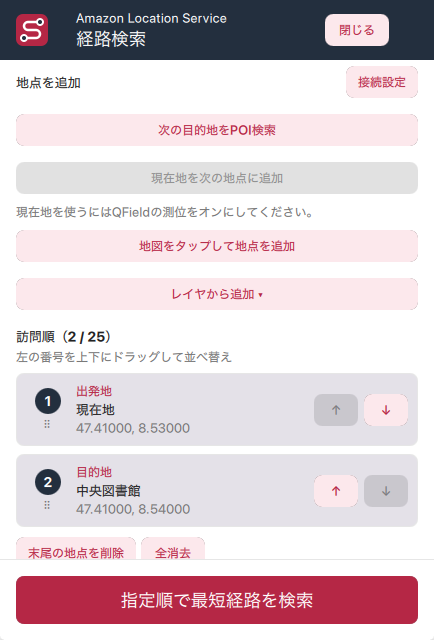
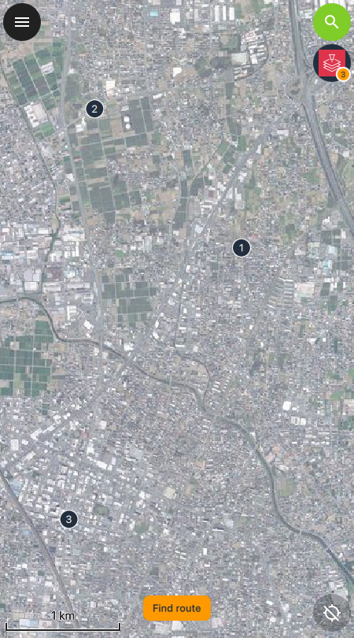
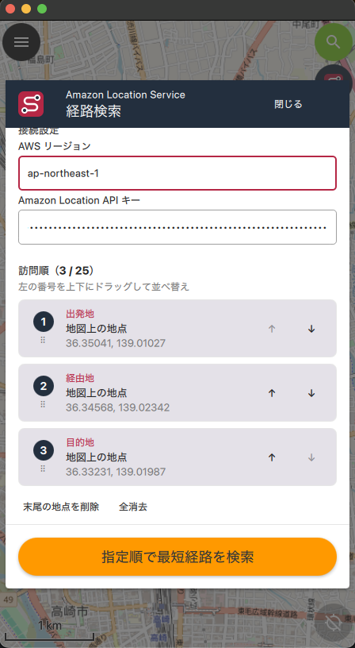

# Amazon Location Service for QField

QField で施設名や住所から場所を探し、地図に表示できます。車で向かうときは、現在地や任意の出発地からその場所までの経路を検索できます。経由地を含む場合は、指定した訪問順で 2〜25 地点を巡ります。

## 必要なもの

- プラグインに対応した QField
- インターネット接続
- Amazon Location Service の API キーと、そのキーを作成した AWS リージョン名（例：`ap-northeast-1`）

| 使用する機能 | API キーに許可するアクション |
| --- | --- |
| 施設名・住所からの POI 検索 | `geo-places:SearchText` |
| 車の経路検索 | `geo-routes:CalculateRoutes` |

両方の機能を使う場合は、同じキーに両方のアクションを許可してください。既存の経路検索用キーには `geo-places:SearchText` を追加します。[API キーの設定](https://docs.aws.amazon.com/location/latest/developerguide/using-apikeys.html)

## インストール

旧 ZIP（`amazon-location-routes.zip`）から切り替える場合は、先にプラグイン管理画面で旧版を無効にしてください。QField は ZIP のファイル名からインストール先を決めるため、新旧のプラグインが別々に登録されます。

### URL からインストールする（おすすめ）

1. QField のサイドダッシュボードを開き、メニューの「Plugin Manager」をタップします。

   

2. プラグイン管理画面の下部にある「URL からプラグインをインストール」をタップします。入力欄に次の URL を貼り付け、「OK」を押します。

   ```text
   https://raw.githubusercontent.com/Yamazaki-Kei7/qfield-amazonlocationservice/main/amazon-location-service.zip
   ```

   

3. 「ローカルプラグイン」タブで 「Amazon Location Service」の右側にあるスイッチをオンにします。実行の許可を求めるダイアログが出たら許可してください。

プラグイン管理画面の場所やボタンの表記は QField のバージョンによって異なります。見つからない場合は [QField のプラグインのドキュメント](https://docs.qfield.org/how-to/advanced-how-tos/plugins/)を確認してください。

### ZIP を手動で配置する

URL からインストールできない環境では、[amazon-location-service.zip](https://raw.githubusercontent.com/Yamazaki-Kei7/qfield-amazonlocationservice/main/amazon-location-service.zip) をダウンロードして展開し、QField のアプリデータ内に `plugins/amazon-location-service/main.qml` がある構成で配置します。QField を再起動し、プラグイン管理画面で有効にしてください。

## 使い方

### 接続設定

地図右上の赤いサービスボタン  をタップすると、その下に「POI検索」（虫眼鏡）と「経路検索」（経路線）の丸いボタンが縦に並びます。サービスボタンをもう一度タップすると、2つのボタンを収納できます。検索ボタンを選ぶと、その検索画面が開き、地図上のボタンは収納されます。初回は検索画面の「接続設定」で AWS リージョンと API キーを入力して「完了」を押します。設定は両方の機能で共通です。


### 場所を探して地図に表示する

サービスボタン → 「POI検索」を選び、施設名・住所・「コンビニ」などのキーワードを入力して「検索」を押します。地図の中心に近い候補が優先されます。施設名と住所を確認して候補を選ぶと、地図がその場所に移動してマーカーが付きます。「候補に戻る」で別の場所を見比べられます。


地図で「現在地からの経路」を押すと、現在地を出発地、表示中の場所を目的地として経路画面が開きます。測位していない場合は「ここへの経路」を押して出発地を選んでください。すでに訪問順がある場合は「目的地として追加」でその末尾に追加できます。

### 現在地から目的地までの経路を検索する

1. QField の測位をオンにして、サービスボタン → 「経路検索」を選びます。「現在地を出発地にする」を押します。現在地は押した時点の位置で固定されます。
2. 「目的地をPOI検索」で施設名や住所を検索し、候補をタップします。目的地を先に選んだ場合は、次に現在地・地図・レイヤ・POI検索から出発地を追加できます。
3. 訪問順を確認して「指定順で最短経路を検索」を押すと、車の経路が地図に表示されます。



### 地図やレイヤから地点を追加する

**地図から追加する場合**は「地図をタップして地点を追加」を押し、出発地から順に地図をタップします。下の例では、黒い丸の **1 が出発地、2 が経由地、3 が目的地**です。



2 地点以上を追加したら、その順でよければ地図下部の「経路を検索」を押すと経路が表示されます。「接続設定を入力」と表示された場合は、タップしてリージョンとキーを入力できます。

**レイヤから追加する場合**は、経路検索画面で「レイヤから追加」を開き、「地物を選ぶレイヤ」で対象のレイヤを選び、「レイヤの地物を選択」を押します。下の一覧で地物名を訪問順にタップすると、画面上部の地点数が増えます。必要な地点を追加したら、右上の「選択を終了」を押して訪問順を確認します。地図で指定した地点と組み合わせることもできます。


### 訪問順を確認して検索する

地図で地点を追加している間は、サービスボタンに地点数が表示されます。サービスボタン → 「経路検索」で経路検索画面に戻り、「訪問順」の一覧で上から出発地、経由地、目的地の順に並んでいることを確認します。



順番を変えるには、カード左端の番号を上下にドラッグするか、右端の「↑」「↓」で 1 つずつ移動します。「末尾の地点を削除」を押すと一覧の最後の地点が消えます。「全消去」を押すと地点と経路がすべて消えます。

訪問順が決まったら「指定順で最短経路を検索」を押します。

### 地図で経路を確認する

検索が完了すると地図に戻り、経路全体が表示されます。下の例では、青い線が **1 → 2 → 3** の順に道路を通る経路です。経路と地点番号は地図上の一時表示で、プロジェクトの地物は変更されません。


### 知っておくと便利なこと

- 「指定順で最短経路を検索」が押せないときは、ボタンの上に不足している項目が表示されます。地点が2つ以上あり、接続設定がそろうとボタンが赤色になります。
- 地物で指定した場合、点はその位置、線・面・マルチパート地物は重心を使います。建物の出入口など特定の位置から検索したいときは、地図をタップして指定してください。
- 地点の追加・並べ替え・削除をすると、表示済みの経路は消えます。新しい順序でもう一度検索してください。
- 別のプロジェクトを開くと、POI のマーカー、地点と経路はクリアされます。
- API キーは端末に保存しません。QField を再起動したときは入力し直してください。

## うまくいかないとき

| 表示・症状 | 確認すること |
| --- | --- |
| 地図右上にサービスボタンが出ない | プラグイン管理画面でスイッチがオンになっているか、実行を許可したかを確認します。 |
| POI検索で HTTP 403 が表示される | キーの期限とリージョン、および `geo-places:SearchText` の許可を確認します。 |
| 現在地を追加できない | QField と端末の位置情報設定を確認し、有効な測位結果を待ちます。地図・レイヤ・POI検索からも出発地を指定できます。 |
| 「通信できません。接続を確認してください。」 | インターネット接続と、リージョン名の入力ミスがないかを確認します。 |
| 「検索できませんでした（HTTP …）。」 | API キーが正しく有効期限内か、`geo-routes:CalculateRoutes` を許可しているか、キーを作成したリージョンを入力しているかを確認します。地点が道路から大きく離れている場合にも表示されることがあります。 |
| 「全区間を通る経路が見つかりませんでした。」 | 車でたどり着けない地点（海上や道路のない場所など）が含まれていないかを確認します。 |
| 「応答がありません。接続を確認して再検索してください。」 | 45 秒以内に応答がなかった場合に表示されます。通信環境のよい場所で再検索します。 |

## 注意事項

- POI 検索と経路検索は Amazon Location Service の利用料金の対象です。詳しくは[料金ページ](https://aws.amazon.com/location/pricing/)を確認してください。
- POI 検索は入力した検索語と地図中心の座標、経路検索は指定した各地点の座標を、API キーとともに Amazon Location Service に送信します。[SearchText の仕様](https://docs.aws.amazon.com/location/latest/APIReference/API_geoplaces_SearchText.html)・[CalculateRoutes の仕様](https://docs.aws.amazon.com/location/latest/APIReference/API_CalculateRoutes.html)
- 移動手段は車のみです。

## 開発者向け

配布用の ZIP は、このディレクトリで次のコマンドを実行して作成します。

```sh
zip -j amazon-location-service.zip main.qml PlaceSearch.qml LocationRequest.qml LocationButton.qml ButtonColors.js Routes.js metadata.txt icon.svg Arch_Amazon-Location-Service_32.svg LICENSE
```

URL からのインストールでは `main` ブランチの `amazon-location-service.zip` がそのまま配布されます。ソースを変更したら、`metadata.txt` の `version` を更新し、ZIP を作り直してコミットしてください。

## ライセンス

プラグインのライセンスは同梱の [LICENSE](LICENSE)（GNU GPL v2）を参照してください。

プラグインのアイコンには、AWS が配布する Amazon Location Service のアーキテクチャアイコンを使用しています。[AWS Architecture Icons](https://aws.amazon.com/architecture/icons/)
